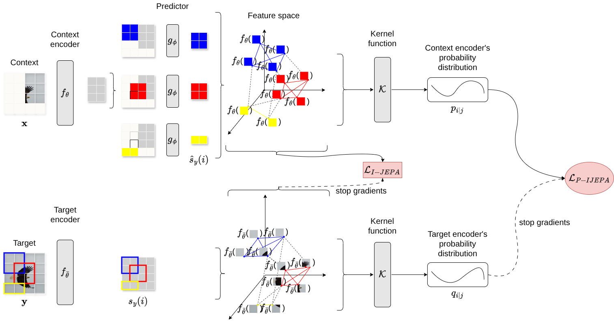

# pijepa

P-IJEPA learns image features without labels. I-JEPA predicts features for hidden patches from the visible part of an image. P-IJEPA adds a second loss that helps the predictions preserve similarities between patches. [Research paper](https://doi.org/10.1016/j.patrec.2026.07.005)

<details>
<summary>Architecture diagram</summary>



The context encoder processes the visible patches. The predictor estimates the features of hidden patches. The target encoder supplies the features that guide training.

</details>

## Run on one GPU

P-IJEPA originally used a Conda environment on Linux. Both setup options require an NVIDIA GPU that supports BF16 and CUDA 11.8.

1. Open a terminal in this repository.
2. Choose one setup option.

   **Conda (original setup)**  
   Create the environment with Python 3.12. Install PyTorch with Conda, then install the remaining packages with pip.

   ```bash
   conda create -n pijepa python=3.12 pip pytorch=2.2.1 torchvision=0.17.1 pytorch-cuda=11.8 -c pytorch -c nvidia -c defaults
   conda activate pijepa
   python -m pip install -r requirements.txt
   ```

   **Fallback with venv and pip**  
   If Conda is unavailable, create a virtual environment with Python 3.11.

   ```bash
   python3.11 -m venv .venv
   source .venv/bin/activate
   python -m pip install torch==2.2.1 torchvision==0.17.1 --index-url https://download.pytorch.org/whl/cu118
   python -m pip install -r requirements.txt
   ```

3. Create the ImageNet-100 folders under the repository root. Use the same class folder names in `train/` and `val/`.

   ```text
   datasets/imagenet100/
   ├── train/
   │   ├── class_a/image1.jpg
   │   └── class_b/image2.jpg
   └── val/
       ├── class_a/image3.jpg
       └── class_b/image4.jpg
   ```

   Replace `class_a` and `class_b` with your class names. The loader uses these names to assign labels.
   Put at least one supported image, such as a JPEG, in each class folder.

4. Start training.

   ```bash
   python main.py --fname configs/pijepa.yaml --devices cuda:0
   ```

Find checkpoints, training logs, and TensorBoard data in `runs/pijepa/`. Adjust `data.batch_size` to fit your GPU memory.

## Examples

| Configuration | Purpose |
| --- | --- |
| `configs/pijepa.yaml` | Train ViT-B/16 with the combined loss (`L2_PKT`). |
| `configs/ijepa.yaml` | Train the same model with the baseline loss (`L2`). |
| `configs/probe.yaml` | Train a linear classifier on features from saved P-IJEPA checkpoints. |

For the baseline, use `configs/ijepa.yaml` in step 4. More configurations can be found in the original [ijepa repository](https://github.com/facebookresearch/ijepa/tree/main/configs). For linear probing, wait for training to save a numbered checkpoint. Then run:

```bash
python pmulti-linear-probing.py --fname configs/probe.yaml
```

Choose the evaluation GPU with `meta.device` in `configs/probe.yaml`.

## Reference

<details>
<summary>Training settings</summary>

Edit the YAML file you pass to `main.py`. These defaults come from `configs/pijepa.yaml`.

| Setting | Default | Purpose |
| --- | --- | --- |
| `data.root_path` / `data.image_folder` | `datasets/` / `imagenet100` | Locate the dataset and its splits. |
| `data.batch_size` | 16 | Set the number of images per GPU per batch. |
| `optimization.epochs` | 300 | Set the number of training epochs. |
| `optimization.loss_function` | `L2_PKT` | Use the combined loss. Select `L2` for the baseline. |
| `logging.folder` | `runs/pijepa` | Choose where training writes its outputs. |
| `logging.checkpoint_freq` | 150 | Set the interval in epochs between numbered checkpoints. |

</details>

<details>
<summary>Checkpoints, training metrics, and linear probing</summary>

The training script writes the latest weights to `runs/pijepa/jepa-in100-latest.pth.tar`. With the default settings, it also writes numbered checkpoints such as `jepa-in100-ep150.pth.tar`.

To view training metrics, start TensorBoard and open the URL it prints.

```bash
tensorboard --logdir runs/pijepa
```

For linear probing, list the training folders under `multi_probing` in `configs/probe.yaml`. Set `data.probe_prefix` to the training run’s `logging.write_tag`. The probe evaluates each matching numbered checkpoint.

</details>

<details>
<summary>Results from the paper</summary>

The authors pretrained ViT-B for 500 epochs, froze the encoder, and trained a linear classifier. Values show mean validation accuracy (%) and standard deviation across three seeds.

| Dataset | I-JEPA | P-IJEPA |
| --- | ---: | ---: |
| IIC | 78.74 ± 0.59 | 80.13 ± 0.48 |
| STL-10 | 68.82 ± 0.29 | 72.44 ± 0.52 |
| ImageNet-100 | 56.79 ± 1.18 | 58.20 ± 1.04 |

</details>

<details>
<summary>Cite P-IJEPA (BibTeX)</summary>

```bibtex
@article{gogos2026probabilistic,
  title   = {Probabilistic image-based joint embedding predictive architecture},
  author  = {Gogos, Lazaros and Katsikas, Dimitrios and Passalis, Nikolaos and Tefas, Anastasios},
  journal = {Pattern Recognition Letters},
  volume  = {207},
  pages   = {234--240},
  year    = {2026},
  doi     = {10.1016/j.patrec.2026.07.005}
}
```

</details>

This implementation builds on [I-JEPA](https://github.com/facebookresearch/ijepa). See the [license](LICENSE) for terms.
